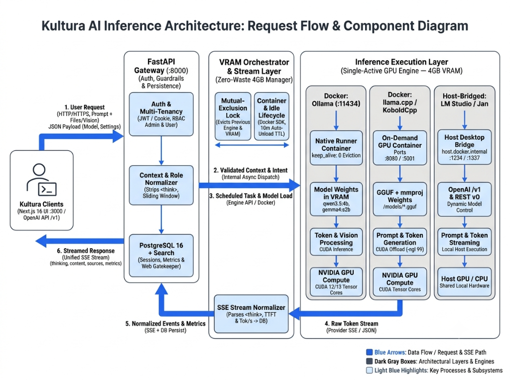

<h1 align="center">Kultura</h1>

<p align="center">Local Multi-Provider AI Inference Gateway & Dark-Themed Web UI with Zero-Waste VRAM Management.</p>

<p align="center">
  <a href="https://nextjs.org"></a>
  <a href="https://react.dev"></a>
  <a href="https://fastapi.tiangolo.com"></a>
  <a href="https://www.postgresql.org"></a>
  <a href="https://www.nvidia.com"></a>
</p>

<p align="center">
  
</p>

## Architecture Overview

Kultura connects the Next.js 16 frontend (`client/`) to a Python 3.12 FastAPI **Aggregation Gateway & Lifecycle Orchestrator** (`server/`). It is optimized for 4GB VRAM GPUs (e.g. NVIDIA RTX 3050 Laptop) using a **Mutual-Exclusion "Zero-Waste VRAM Manager"** that ensures only one engine and model occupies GPU memory at any given time.

### Supported Providers (5 Total)
1. **Ollama**: Dockerized on port `11434` with on-demand `keep_alive: 0` eviction.
2. **llama.cpp**: Dockerized `llama-server` with CUDA on port `8080`.
3. **KoboldCpp**: Dockerized `koboldcpp` with CUDA on port `5001`.
4. **LM Studio**: Host-bridged via `host.docker.internal:1234` + REST v0 control.
5. **Jan**: Host-bridged via `host.docker.internal:1337` local server.

---

## Key Features

- **Single-Gateway Mutual Exclusion**: Unloads preceding models and stops conflicting GPU containers before launching the target model.
- **Unified SSE Streaming**: Normalizes raw output from all 5 engines, real-time separation of `<think>...</think>` and `reasoning_content` tags into distinct SSE events (`thinking`, `content`, `metrics`, `done`).
- **Telemetry & Metrics**: Live tokens/sec, Time-To-First-Token (TTFT), thinking duration, and token counts.
- **Multimodal Vision**: Encodes image attachments to OpenAI-compatible base64 `image_url` data URIs for vision models (`qwen3.5:4b` and `gemma4:e2b`).
- **Strict PostgreSQL 16 Persistence**: Saves sessions, messages, reasoning traces, attachments, and metrics across reloads.
- **Idle Auto-Unload TTL**: Background worker frees VRAM after 10 minutes of inactivity.

---

## Getting Started

### 1. Download Model Weights
Run the helper script to download shared GGUF weights, vision mmproj projectors, and pull Ollama models:

```bash
./server/scripts/download-models.sh
```

### 2. Launch Entire Connected Stack (Frontend + Backend + PostgreSQL)
Start all services in Docker:

```bash
docker compose up -d
```

Open [http://localhost:3000](http://localhost:3000).

*Note: GPU inference containers (`ollama`, `llamacpp`, `koboldcpp`) are on-demand profiles and will be started automatically by the gateway when selected.*

---

## Publishing to Docker Hub

You can build and publish the container images to Docker Hub with models baked in during build creation:

```bash
# Build images with model weights included during build creation:
./server/scripts/docker-publish.sh YOUR_DOCKERHUB_USERNAME --with-models

# Push to Docker Hub:
docker push YOUR_DOCKERHUB_USERNAME/kultura-frontend:latest
docker push YOUR_DOCKERHUB_USERNAME/kultura-gateway:latest
```

Once pushed, anyone can run your entire platform simply by pulling your image or using `docker compose up`.

---

## API Documentation

Interactive Swagger documentation is available at:
[http://localhost:8000/docs](http://localhost:8000/docs)

- `GET /api/providers`: Provider statuses and container health.
- `GET /api/providers/vram`: Real-time NVIDIA VRAM telemetry.
- `GET /api/providers/{provider}/models`: Available models (scans `/models/*.gguf` even when stopped).
- `POST /api/providers/{provider}/load`: SSE stream of model loading progress.
- `POST /api/providers/unload`: Manual VRAM eject button.
- `POST /api/chat/completions`: Unified streaming chat endpoint with multimodal vision.
- `GET/POST/PATCH/DELETE /api/sessions`: Chat history management.
