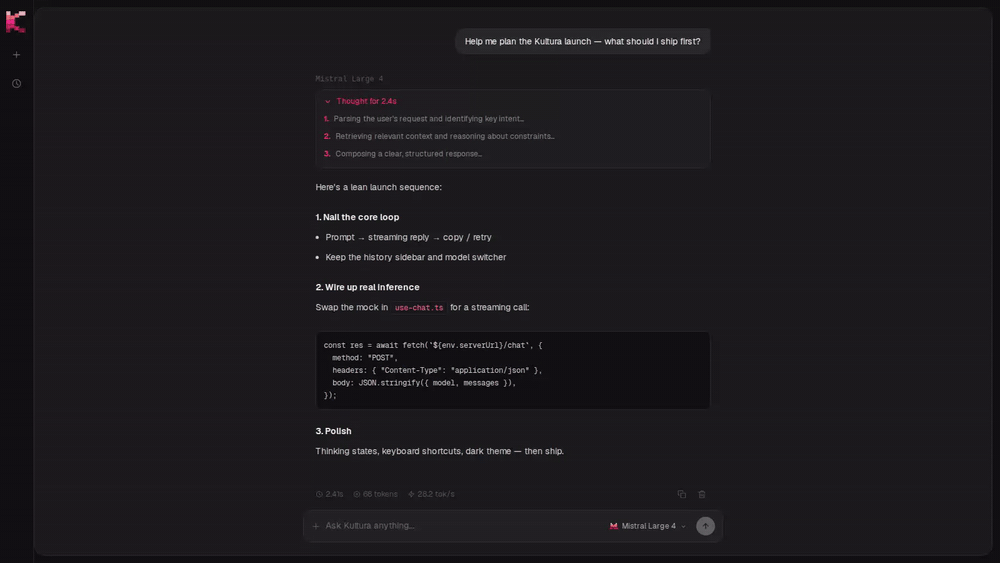
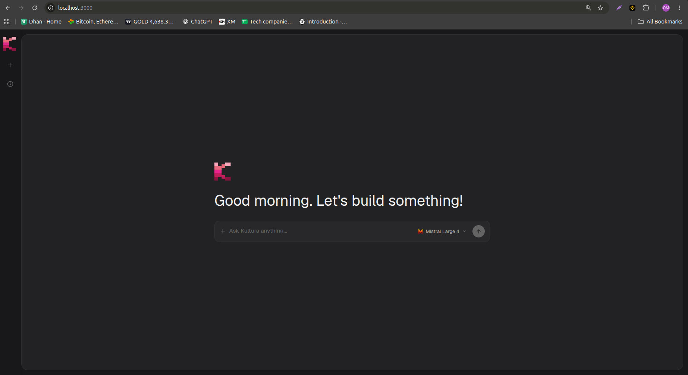

<h1 align="center">Kultura</h1>

<p align="center">A minimal, dark-themed chat interface built with Next.js.</p>

<p align="center">
  <a href="https://nextjs.org"></a>
  <a href="https://react.dev"></a>
  <a href="https://www.typescriptlang.org"></a>
  <a href="https://tailwindcss.com"></a>
</p>

<p align="center">
  
</p>

## Features

- Streaming-style replies with collapsible thinking steps
- Model switcher for the Mistral family
- Resizable chat history sidebar
- Markdown and code block rendering
- Message stats, copy, and delete actions
- Fully dark UI

## Getting started

```bash
npm install --prefix client
cp .env.example .env

npm run dev
```

Open [http://localhost:3000](http://localhost:3000).

## Stack

Next.js 16 · React 19 · TypeScript · Tailwind CSS 4

## Recording the demo

The walkthrough above is produced by a Playwright script:

```bash
python3.12 automation/record_demo.py
```

It starts the dev server, records the flow, and writes a raw video to `automation/recordings/`. The rendered clip is also available as [assets/demo.mp4](assets/demo.mp4).

<details>
<summary>Static screenshot</summary>
<p align="center"></p>
</details>
